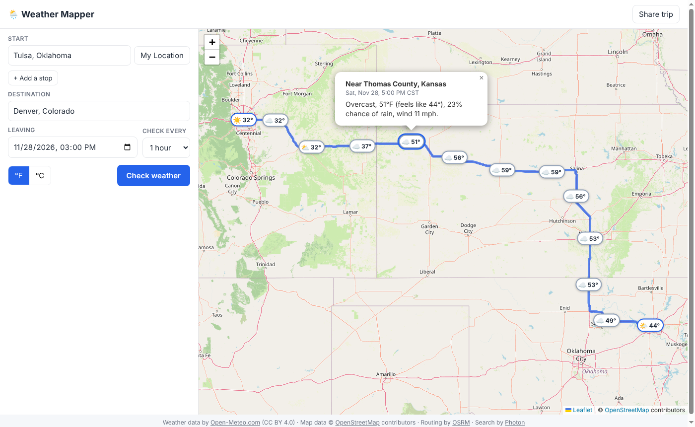

# Weather Mapper

See the weather along a road trip at the time you'll actually be at each point, not just the forecast for where you start and where you end up.

**Try it: https://jk1834.github.io/WeatherMapper/**



## Features

- **Weather on your schedule.** Pick a departure time and the app works out when you'll reach each point along the route, then shows the forecast for that hour.
- **Stops and overnights.** Add up to 8 stops with how long you'll stay, and the rest of the drive is timed from when you leave.
- **Tap any pin for details.** A short summary of the conditions there: temperature, "feels like", rain or snow, wind and gusts, plus a warning for things like ice, snow, storms or strong gusts.
- **Trips already under way.** Points you've already passed show the weather from that hour, so the map stays useful while you drive.
- **Share a trip with a link.** The whole trip is stored in the link, so anyone who opens it sees the same route with up-to-date weather. Bookmark a link to save a trip.
- **°F or °C**, with wind in mph or km/h to match.
- **No account, no API keys, no ads.** It's a static page that talks directly to free public services.

## How to use it

1. Type a **Start** and a **Destination**. Pick from the suggestions, or just type and press **Check weather**. **My Location** fills in where you are now.
2. Optionally add stops with **+ Add a stop**. The "h stay" box is how long you'll be there; use something like 12 for an overnight stop.
3. Set when you're **Leaving** and how often to **Check every** (30 minutes, 1 hour or 2 hours of driving).
4. Press **Check weather**. Each pin on the map shows the expected conditions and temperature for when you'll pass it. Tap a pin for more detail.

## What the pins mean

| Pin | Meaning |
| --- | --- |
| Weather icon and temperature | The forecast for the hour you'll be at that point |
| Blue border | Start and destination |
| Purple border | A stop |
| Red ✕ | No forecast for that time yet |

- **Forecasts reach 16 days ahead.** Points further out than that show a red ✕, and the app tells you when to check back. Forecasts become less reliable after about a week, so check again closer to the date.
- **Past hours** (up to about 3 months back) show what the weather was at that hour.
- **Drive times** come from the routing service and assume no traffic or breaks, so treat arrival times as a best case.

## Run it on your own computer

You need Python, which is already installed on most Macs and Linux machines (on Windows, get it from [python.org](https://www.python.org/downloads/)).

```bash
git clone https://github.com/jk1834/WeatherMapper.git
cd WeatherMapper
python3 -m http.server 8000     # on Windows: python -m http.server 8000
```

Then open http://localhost:8000 in your browser.

There's no build step and nothing else to install; any simple static file server works.

## How it's built

Plain HTML, CSS and JavaScript modules, with [Leaflet](https://leafletjs.com/) for the map. Everything runs in the browser.

```
index.html          page layout
css/style.css       styling
js/config.js        addresses of the outside services and app limits (edit here to swap services)
js/main.js          connects the form and the map
js/routing.js       gets the driving route (OSRM)
js/sampling.js      picks the weather check points and when you'll reach each one
js/weather.js       hourly weather for each point (Open-Meteo)
js/geocode.js       place search and nearest-town names (Photon)
js/placeField.js    the search boxes with suggestions
js/mapView.js       the map, route line and weather pins
js/details.js       the text shown when you tap a pin
js/tripUrl.js       saves and loads a trip in the page link
js/format.js        weather icons, units, times and driving hazards
js/geo.js           distance helpers
js/dom.js           small helper for building page elements
```

## Data and credits

Weather Mapper relies on these free services. Please keep their attribution in place and keep usage light if you run your own copy.

- Weather: [Open-Meteo](https://open-meteo.com/) (CC BY 4.0, free for non-commercial use)
- Map data and tiles: [OpenStreetMap](https://www.openstreetmap.org/copyright) contributors
- Routing: [OSRM](https://project-osrm.org/), via routing.openstreetmap.de with router.project-osrm.org as a fallback
- Place search: [Photon](https://photon.komoot.io/) by komoot
- Map library: [Leaflet](https://leafletjs.com/)

## License

[MIT](LICENSE)
